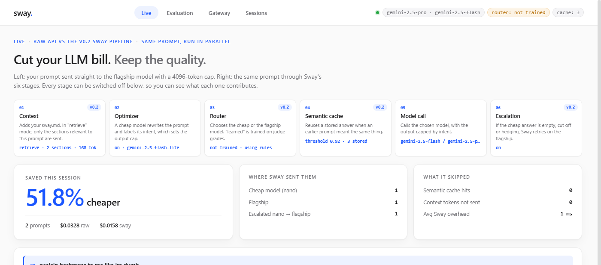
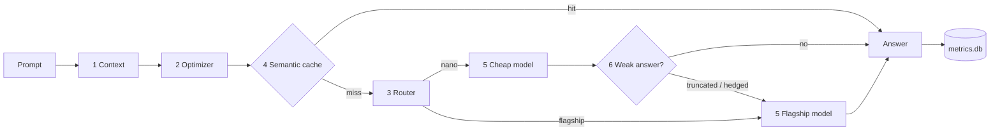
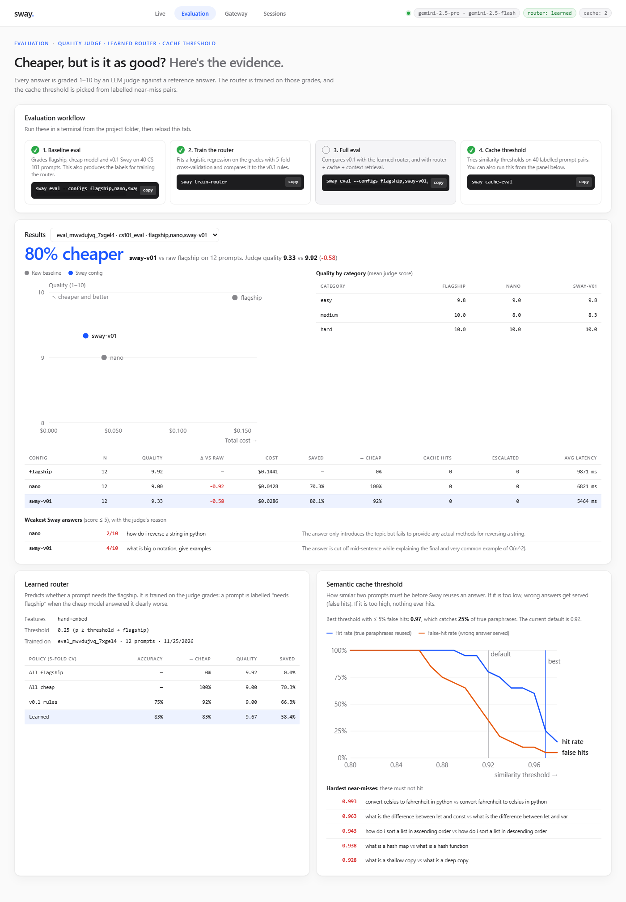
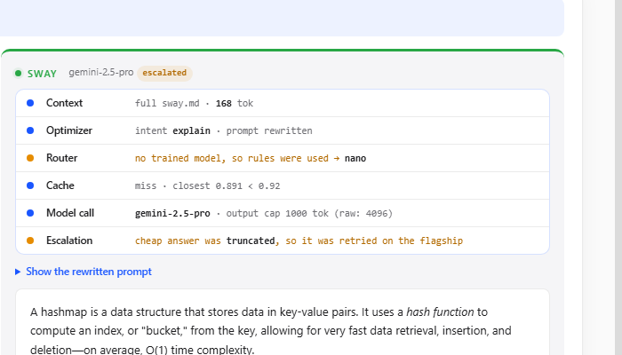
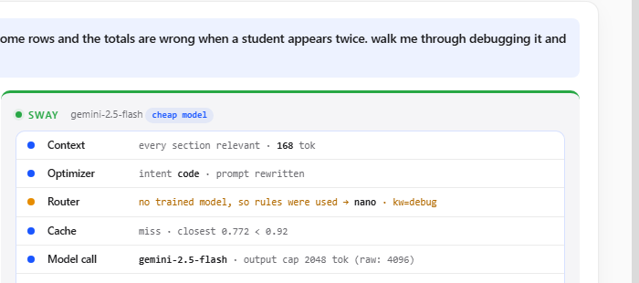
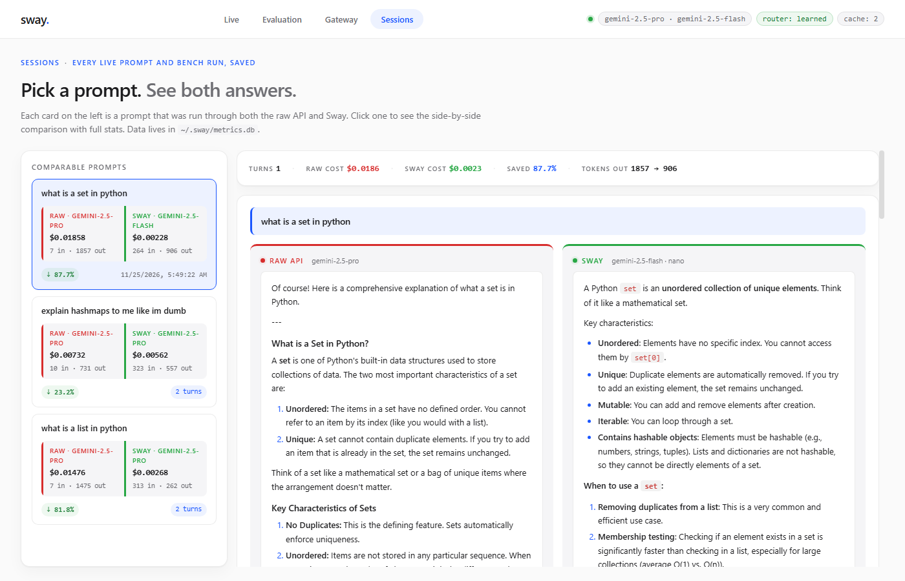
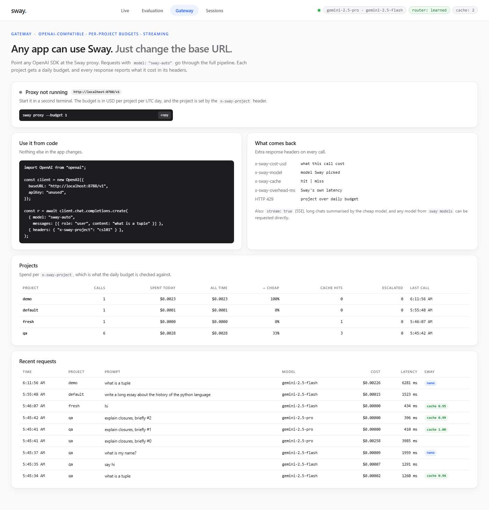

# Sway — a cost-aware LLM gateway

**Cut your LLM bill. Keep the quality. And prove it.**

Sway sits between your app (or terminal) and the LLM provider. Every prompt goes through a
six-stage pipeline that sends as little as possible to the most expensive model, and an
evaluation harness grades the answers so the savings are not bought with worse output.

> **Measured result** (CS-101 eval set, Gemini 2.5, answers graded 1–10 by an LLM judge against reference answers):
> Sway was **80.1% cheaper** than sending every prompt to the flagship model, at quality **9.33 vs 9.92**.
> On a second run it was **85.7% cheaper at identical quality (10.0 vs 10.0)**. Details and caveats in [Proof](#proof).



---

## Contents

- [The problem](#the-problem)
- [How it works](#how-it-works)
- [Proof](#proof)
- [Run it locally](#run-it-locally)
- [Use it from any app (gateway)](#use-it-from-any-app-gateway)
- [Reproduce the results](#reproduce-the-results)
- [Project layout](#project-layout)
- [Honest caveats](#honest-caveats)

---

## The problem

Most apps send every prompt to one flagship model. That overpays in three ways:

1. **Easy prompts go to the expensive model.** "What is a tuple?" does not need Gemini 2.5 Pro.
2. **The same question is paid for again and again.** Paraphrases ("explain closures" / "what's a closure?") get a fresh, full-price answer each time.
3. **Too many tokens go in and out.** Whole context files get pasted into every call, and loose prompts produce long, rambling answers.

Cost tools usually report savings without checking whether the answers got worse. Sway measures both.

---

## How it works



| # | Stage | What it does | Code |
|---|---|---|---|
| 1 | **Context** | Loads your project's `sway.md` as a system message. In `retrieve` mode only the sections relevant to this prompt are sent. Long chat histories are summarised by the cheap model. | [`src/context.ts`](src/context.ts) |
| 2 | **Optimizer** | A very cheap model (Gemini Flash-Lite) labels the intent (`code`, `qa`, `refactor`, `explain`, `other`) and rewrites the prompt into a tight template. Pasted code and long messages are kept verbatim. | [`src/optimizer.ts`](src/optimizer.ts) |
| 3 | **Router** | Decides **nano** (cheap) or **flagship**. v0.1 used keyword rules; v0.2 uses a **logistic regression** trained on the judge's grades, over hand features + the prompt's embedding. | [`src/router.ts`](src/router.ts), [`src/learned-router.ts`](src/learned-router.ts) |
| 4 | **Semantic cache** | Embeds the prompt and reuses a stored answer if a previous prompt was similar enough (cosine ≥ threshold) **and** was answered under the same context. The threshold is chosen from labelled near-miss pairs, not guessed. | [`src/semcache.ts`](src/semcache.ts), [`src/embeddings.ts`](src/embeddings.ts) |
| 5 | **Model call** | Calls the chosen model through one adapter for Gemini, OpenAI, Anthropic or Bedrock. Streaming supported. | [`src/providers.ts`](src/providers.ts) |
| 6 | **Escalation** | If the cheap answer was cut off (hit ≥98% of its token cap) or hedged ("I'm not sure…"), Sway retries on the flagship. This is the safety net that lets the router be aggressive. | [`src/pipeline.ts`](src/pipeline.ts) |

Every call is logged to a local SQLite file (`~/.sway/metrics.db`) with model, tokens, cost, cache hit and escalation, which is what the dashboard and reports read.

### How the router learns

1. `sway eval` sends each prompt in the dataset to **both** the cheap and the flagship model and the judge grades both answers.
2. A prompt is labelled **"needs flagship"** when the cheap answer scored below 7, or more than 1 point below the flagship's.
3. `sway train-router` fits an L2 logistic regression (pure TypeScript, no ML library) with 5-fold cross-validation, compares it with the v0.1 rules, and saves it to `~/.sway/router.json`.

### How the cache threshold is chosen

[`evals/cache_pairs.json`](evals/cache_pairs.json) holds 40 labelled prompt pairs: true paraphrases that **should** share an answer, and near-misses that **must not** ("convert celsius to fahrenheit" vs "convert fahrenheit to celsius"). `sway cache-eval` sweeps thresholds and reports hit rate against false-hit rate.

---

## Proof

All numbers below come from real runs against the Gemini API (flagship `gemini-2.5-pro`, cheap `gemini-2.5-flash`), recorded in the dashboard. Screenshots are unedited.

### 1. Cost vs quality (Evaluation tab)



**Run `eval_mwvdujvq_7xgel4`** — 12 CS-101 prompts (easy / medium / hard), every answer graded by the judge:

| Config | Quality (1–10) | Δ vs flagship | Cost | Saved | Sent to cheap model |
|---|---|---|---|---|---|
| flagship (raw API) | 9.92 | – | $0.1441 | – | 0% |
| nano (raw API) | 9.00 | −0.92 | $0.0428 | 70.3% | 100% |
| **sway-v01** | **9.33** | **−0.58** | **$0.0286** | **80.1%** | 92% |

**Run `eval_mwvdi2j1_kgjt81`** — 10 prompts:

| Config | Quality | Δ vs flagship | Cost | Saved |
|---|---|---|---|---|
| flagship (raw API) | 10.00 | – | $0.1201 | – |
| nano (raw API) | 10.00 | 0.00 | $0.0280 | 76.7% |
| **sway-v01** | **10.00** | **0.00** | **$0.0172** | **85.7%** |

What this shows: Sway is cheaper than even "always use the cheap model", because the optimizer and context also cut output tokens (10.5k vs 14.4k out in run 1), and it keeps quality closer to the flagship than nano alone does.

The dashboard also lists the weakest answers with the judge's reason, so failures are visible rather than averaged away (e.g. one sway-v01 answer scored 4/10 because it was cut off mid-sentence — the case escalation is designed to catch).

### 2. The learned router beats the keyword rules

From `~/.sway/router.json`, trained on run `eval_mwvdujvq_7xgel4` with 5-fold cross-validation:

| Policy | Accuracy | Sent to cheap | Quality | Saved |
|---|---|---|---|---|
| All flagship | – | 0% | 9.92 | 0.0% |
| All cheap | – | 100% | 9.00 | 70.3% |
| v0.1 keyword rules | 75% | 92% | 9.00 | 66.3% |
| **Learned (hand + embedding features)** | **83%** | 83% | **9.67** | 58.4% |

The learned router picks the flagship for the prompts that actually need it, recovering most of the quality gap (9.67 vs 9.92) while still saving 58%.

### 3. Semantic cache threshold (from the labelled sweep)

The sweep (right panel of the Evaluation screenshot) shows the trade-off: at **0.97**, false hits stay ≤ 5% while 25% of true paraphrases are reused. The hardest near-misses score 0.93–0.99 similarity, which is why a low threshold is dangerous and why Sway also requires the same context hash before reusing an answer.

### 4. Every stage is traceable (Live tab)

Each Sway answer comes with a per-stage trace. Here the router chose the cheap model, the answer was truncated, and escalation retried it on the flagship:



And a debugging prompt routed to the cheap model with a 2048-token cap (raw: 4096):



### 5. Side-by-side answers (Sessions tab)

Same prompt, raw API vs Sway, with cost and tokens. "What is a set in Python": raw $0.0186 vs Sway $0.0023 — **87.7% cheaper**, 906 vs 1857 output tokens.



### 6. Drop-in gateway (Gateway tab)

Real requests through the OpenAI-compatible proxy, grouped by project. Rows tagged `cache 0.94`–`1.00` were served from the semantic cache at **$0.00000** and ~400 ms instead of ~4 s.



### 7. Tests

```bash
npm test     # 14 unit tests, all passing (no API calls)
```

Covers regression training, cosine similarity, the threshold sweep, section splitting, history compression, judge parsing, escalation rules, SSE format and eval aggregation.

---

## Run it locally

Requires **Node.js 20+**.

```bash
git clone https://github.com/dhrupad777/Sway.git
cd Sway
npm install
npm run build
```

Add one API key to a `.env` file in the folder you run Sway from (or export it in your shell):

| Provider | Key | Flagship / cheap model |
|---|---|---|
| **Gemini** (recommended) | `GEMINI_API_KEY` ([get one](https://aistudio.google.com/apikey)) | gemini-2.5-pro / gemini-2.5-flash |
| OpenAI | `OPENAI_API_KEY` | gpt-4o / gpt-4o-mini |
| Anthropic | `ANTHROPIC_API_KEY` | claude-sonnet-4-6 / claude-haiku-4-5 |
| Amazon Bedrock | `AWS_BEARER_TOKEN_BEDROCK` + `AWS_REGION` | Claude Sonnet 4.5 / Haiku 4.5 |

Then:

```bash
node dist/cli.js probe                 # check the key and each model (costs < $0.001)
node dist/cli.js init                  # create a starter sway.md
node dist/cli.js ask "what is a tuple" # one prompt through the full pipeline
node dist/cli.js serve                 # dashboard at http://localhost:8787
```

(After `npm i -g .` or `npm link`, `node dist/cli.js` becomes just `sway`.)

If several keys are set, Gemini is picked first. Override with `SWAY_PROVIDER=openai|gemini|anthropic|bedrock`, or set single roles with `SWAY_FLAGSHIP`, `SWAY_NANO`, `SWAY_OPTIMIZER`, `SWAY_JUDGE`.
**Embeddings always use Gemini**; without a Gemini key the semantic cache, context retrieval and learned router switch themselves off.

### All commands

```bash
sway ask "..."                 # full pipeline
sway ask --no-optimize "..."   # ablate a stage: --no-context --no-route --no-cache --no-escalate
sway ask --router rules|learned --context-mode full|retrieve --sim 0.95 "..."
sway ask -m gemini-2.5-flash "..."   # force a model
sway stats [--verbose]         # recent calls + totals
sway models                    # known models + prices
sway serve                     # dashboard: Live, Evaluation, Gateway, Sessions
sway proxy --budget 1          # OpenAI-compatible gateway, $1/day per project
sway eval | train-router | cache-eval   # the evidence (see below)
sway bench workloads/default.json       # v0.1 raw-vs-Sway workload benchmark
```

---

## Use it from any app (gateway)

```bash
sway proxy --budget 1
```

```ts
import OpenAI from "openai";
const client = new OpenAI({ baseURL: "http://localhost:8788/v1", apiKey: "unused" });
const r = await client.chat.completions.create(
  { model: "sway-auto", messages: [{ role: "user", content: "what is a tuple" }] },
  { headers: { "x-sway-project": "cs101" } },
);
```

Response headers: `x-sway-cost-usd`, `x-sway-model`, `x-sway-cache` (hit/miss), `x-sway-overhead-ms`.
A project over its daily budget gets **HTTP 429**. `stream: true` is supported (SSE).

---

## Reproduce the results

```bash
sway eval --configs flagship,nano,sway-v01             # baselines + router training labels
sway train-router                                      # rules vs learned, 5-fold CV
sway eval --configs flagship,sway-v01,sway-learned,sway-full
sway cache-eval                                        # threshold sweep
sway eval --list
sway eval --show <runId>
```

Each run writes `reports/<runId>.md` and `reports/<runId>.csv` (one row per graded answer). Use `-n 5` for a cheap smoke test.

| Config | Meaning |
|---|---|
| `flagship`, `nano` | Raw API baselines: no context, no optimizer, 4096-token cap |
| `sway-v01` | Context + optimizer + rules router |
| `sway-learned` | + learned router and escalation |
| `sway-full` | + semantic cache and context retrieval |

---

## Project layout

| File | Role |
|---|---|
| `src/cli.ts` | All commands |
| `src/pipeline.ts` | The shared six-stage pipeline (used by `ask`, `eval`, `proxy`, dashboard) |
| `src/context.ts` | `sway.md` loading, section retrieval, history compression |
| `src/optimizer.ts` | Intent classification + prompt rewrite |
| `src/router.ts`, `src/learned-router.ts` | Rules router and logistic-regression router |
| `src/semcache.ts`, `src/embeddings.ts` | Semantic cache + threshold sweep |
| `src/providers.ts` | Gemini / OpenAI / Anthropic / Bedrock adapters, streaming |
| `src/judge.ts`, `src/eval.ts`, `src/evalstore.ts` | LLM judge and eval harness |
| `src/proxy.ts` | OpenAI-compatible gateway with budgets |
| `src/server.ts` | Dashboard |
| `src/metrics.ts`, `src/pricing.ts` | SQLite logging, $/Mtok table |
| `evals/` | 40-prompt CS-101 dataset with reference answers; 40 labelled cache pairs |
| `test/core.test.ts` | Unit tests |

More background: [MAJOR_PLAN.md](MAJOR_PLAN.md) (v0.2 phases and metrics), [research-paper.md](research-paper.md).

---

## Honest caveats

- **Small samples.** The published runs use 10–12 prompts from one domain (CS-101). They show the mechanism works; they are not a general benchmark. Run `sway eval` on your own traffic.
- **LLM judge.** The judge is the flagship model, so it may favour its own answers. Reference answers and temperature 0 reduce this; `--judge` lets you grade with another model family.
- **Router training data.** The learned router was trained on 12 graded prompts. Retrain on your own data before trusting it elsewhere.
- **Pricing** in `src/pricing.ts` is a snapshot; refresh it before reporting numbers.
- **The optimizer adds one cheap call** per request (~$0.0001). On workloads of all-unique, already-tight prompts it can cost more than it saves — ablate with `--no-optimize` and measure.
- **BYOK, local only.** Keys stay in your environment; all data is in local SQLite at `~/.sway/metrics.db`.

## License

MIT
